<div align="center">
  <picture>
    <source media="(prefers-color-scheme: dark)" srcset="https://raw.githubusercontent.com/mcgrapeng/attest/main/skills/attest/assets/attest-wordmark-dark.png">
    
  </picture>
  <p><strong>Turns "is this module ready to ship?" from a coverage percentage into an auditable evidence list.</strong></p>
</div>

<div align="center">

[](https://github.com/mcgrapeng/attest/actions/workflows/ci.yml)
[](https://skills.sh/b/mcgrapeng/attest)
[](https://www.python.org/)
[](LICENSE)

[中文版](README.zh-CN.md) · [English](README.md)

</div>

```bash
npx skills add mcgrapeng/attest
```

<div align="center">
  
</div>

## What it does

A coverage number tells you the code ran. It does not tell you that an
assertion would fail, that the plan's pins point at files that exist, or that
two stores have not drifted apart. `attest` answers the delivery question with
**evidence**, sorted into four kinds:

<div align="center">
  
</div>

| Evidence kind | What it means |
| --- | --- |
| **Measured** | Something ran: the command, its exit code and its output are in the report |
| **Static signal** | Read out of the source, not run. **Can never support a pass on its own** |
| **Not measured** | Could not be measured, and the report names the precondition that was missing |
| **Not judged** | Out of scope by design: requirement understanding, product behaviour, performance, security, availability, operational readiness |

The tool prints these four kinds in Chinese (已实测 / 静态信号 / 未实测 / 本工具不判定); the report sample below is its real output.

The measurement is real, not inferred. `attest` runs the target repo's **own**
test command, its **own** coverage gate, its **own** reconciliation script, and
queries the PostgreSQL catalog for the actual schema. Where it cannot measure
something, it says so instead of passing it.

**Supported today:** the **readiness checker** measures TypeScript / JavaScript and
Python. (Python's real-backend itest lane can be found and run with
`--include-itest`, but pytest's output is not a shape attest can parse, so that
lane stays *not measured* instead of becoming a verdict.) The **plan generator**
also reads Rust and Go in its reconnaissance and scaffolds for them (`.rs` → cargo
test, `.go` → go test), but the readiness checker stops at the language boundary:
on a Rust or Go module it exits with code 2 and says that only TS/JS/Python is
implemented, rather than reporting on a module it cannot see.

**What it is not.** It is not a "can we ship" referee, and it does not replace
the tools you already have:

| You already know | Where attest differs |
| --- | --- |
| A coverage badge (Codecov, SonarCloud) | attest **drives your repo's own coverage gate** and reports the number your CI already produces; only when a repository has no gate of its own does attest measure coverage itself, as a fallback |
| An AI-written test plan | attest pins every invariant to a test case **that really exists in your repo**, and when it cannot infer your test framework it refuses to scaffold and tells you (`--framework` is the way out) |
| "I asked a chatbot whether this looks done" | attest **runs** the checks and prints the commands it ran: every verdict is re-runnable by you |
| A checklist in a PR comment | attest's report is reproducible: one command, same input, same output |

It reports evidence; the decision stays with whoever owns the delivery. The
name avoids *verify*, *certify* and *sign-off* on purpose: those promise an
approval this tool refuses to fake.

## The two commands

**Line A writes the plan** — `skills/attest/scripts/req_plan.py`:

| Step | Command | What it does |
| --- | --- | --- |
| 1 | `new <feature> --repo . --module src/x` | Scans the module: the helpers it already has, the stores it touches, your test lanes, and the decision points in the code |
| 2 | *fill the plan* | Write the invariants and the coverage matrix; pin each one to a real test case |
| 3 | `upgrade <plan> --repo .` | Re-granularises the plan: one row per decision point, with three columns to fill — which invariant owns it, which case proves it, or why it needs no test |
| 4 | `assign <plan> --repo . --limit 30` | Hands out the decision points still to be answered, as a JSONL worklist (that is what it does by default); `--apply answers.jsonl` checks the answers and writes them back |
| 5 | `scaffold <plan> --repo .` | Writes the test files the plan asks for, in your conventions; the assertions are left as TODO for you to fill |
| 6 | `check <plan> --repo .` | Verifies every pin: does the file exist, does the case exist, is the invariant covered |
| 7 | `reconcile <plan> --repo .` | Generates the cross-store reconciliation script from the plan's data-consistency section — the table and collection names come from the plan, and the slots that are still empty make the script refuse to run, so it cannot silently pass |

Step 4 is what makes the three columns fillable by an agent instead of by hand: in
its default mode `assign` hands out each decision point's code excerpt, the
candidate test files and the plan's own invariants; `--apply` takes the answers
back and writes them in. Anything that does not check out — an invariant that is
not in the list, a waiver that says nothing, a pin to a case that does not exist
— is rejected and left for a human.

**Line B verifies the delivery** — `skills/attest/scripts/readiness.py`:
`readiness.py <module> --repo .` runs your repository's own test lane, coverage
gate, reconciliation script and schema queries, then prints the four kinds of
evidence and one exit code. `--plan <plan>` adds the decision-point criteria;
without it those three are reported as *not measured*, not as passed.

**Nobody has to be in the loop.** An agent that reads the requirement can drive
both lines end to end: derive the invariants from the requirement, fill the plan
in batches with `assign`, write the assertions that `scaffold` leaves as TODO,
confirm the plan (the 确认 section accepts an agent, and the report says who
confirmed it), claim the eight items this tool does not judge, and run the
readiness check. The report ends with a **delivery precondition** summary — the
evidence is green, the plan is confirmed, and nothing is unclaimed — which is
what "may go into the delivery pipeline" means. It is a summary, not another
criterion: the criteria count and the exit code do not change.

## Install

```bash
npx skills add mcgrapeng/attest
```

Three ways in, pick the one that matches you:

| You want to… | Do this |
| --- | --- |
| Use it inside your agent | `npx skills add mcgrapeng/attest`: the skills CLI copies the skill into `.agents/skills/attest/` and detects which agent you run. No clone, no Python |
| Keep the repository | `git clone … && python3 install.py`: symlinks the skill into `~/.agents/skills/attest` and the agent directories |
| Just run it once | `python3 ~/.agents/skills/attest/scripts/readiness.py <module path> --repo <repo root>` |

Those two routes leave the skill in different places: the skills CLI copies it
into the project (`.agents/skills/attest/`), `install.py` symlinks it into your
home (`~/.agents/skills/attest/`). That command is the home path; from the skills
CLI, use `.agents/skills/attest/scripts/readiness.py` instead.

From a clone (this repository is the source of truth):

```bash
git clone https://github.com/mcgrapeng/attest.git && cd attest
python3 install.py
```

The installer symlinks the skill directory (`skills/attest/`) to
`~/.agents/skills/attest`, then symlinks that entry into `~/.claude/skills/`,
`~/.codex/skills/` and `~/.config/opencode/skills/`. An existing symlink with the
same name is replaced (the script says so); if the target path is a **real
directory** the script skips it and never deletes user data. Uninstall with
`python3 install.py --uninstall`: symlinks only. On Windows `os.symlink` may
need administrator rights or developer mode.

Python 3.11+ and nothing else: the tool has **no third-party dependencies**,
and it drives your repository's own toolchain (node, pytest, …) rather than
installing one of its own.

Then, against any repository:

```bash
python3 ~/.agents/skills/attest/scripts/readiness.py <module path> --repo <repo root>
```

### In CI

```yaml
name: attest
on: [pull_request]

jobs:
  attest:
    runs-on: ubuntu-latest
    steps:
      - uses: actions/checkout@v4
      - uses: actions/setup-node@v4
        with:
          node-version: '22'
      - run: npm ci
      - uses: mcgrapeng/attest@v0.1.16
        with:
          module: src/auth
```

| Input | Default | What it does |
| --- | --- | --- |
| `module` | — | **Required.** The module to check, relative to the repository root (`src/auth`) |
| `repo-path` | `.` | The repository root, when it is not the workspace root |
| `plan` | — | A requirement test plan to check the module against |
| `strict` | `false` | Fail the job when attest exits 1 (blocking items, or a key criterion it could not measure) |
| `comment` | `true` | Post the report as a pull request comment |

It publishes the evidence list to the job summary and the PR comment, and
**does not block the merge by default** (`strict: false`): attest reports
evidence, the repository decides. The job stays green even when attest exits 1
(blocking items or an unmeasurable key criterion); with `strict: true` that
exit code fails the job instead. Exit code 2 is the exception: attest could not
read the module, and the action fails the job whatever `strict` is set to.
Install the repository's own dependencies before the action runs: attest runs
the repository's own test command.

## Command-line flags

The switches you are most likely to need:

| Flag | What it does |
| --- | --- |
| `--plan <file>` | The requirement test plan to compare against. **Without it the three decision-point criteria are skipped**, not passed |
| `--database-url <url>` | The PostgreSQL to read the schema from, when it is not the default |
| `--test-tenant <name>` | A tenant that is **not** production data. Repeat it for every test tenant, or the reconciliation counts them as drift |
| `--include-itest` | Include the repository's real-backend itest lane in the measurement (it needs PostgreSQL and the vector store, and it is slow) |
| `--json` | The same report, machine-readable: every check plus the verdict counters |
| `--dry-run` | List the repository scripts that *would* run, and run nothing |
| `--min-line-coverage`, `--min-branch-coverage` | Fallback coverage bars, used only when the repository has no coverage gate of its own |
| `--mutation-check` | Break the source and check that the tests catch it (copies your code first, so your tree is untouched) |
| `--self-check` | Reverse verification: inject a known defect into a copy and prove the criteria turn red (your repository is not touched) |

Three more switches belong to the decision-point engine (the fourth, `--plan`, is
above). None of them can turn a red into a green: a missing capability degrades
to a warning or to *not measured*.

| Flag | What it does |
| --- | --- |
| `--discriminating {auto,off,quick,full}` | Whether to break the source at each pin and check that the pinned test case catches it. `auto` runs it only for decision-point-grained plans, `off` skips it, `quick`/`full` widen the sample (expensive) |
| `--analysis-backend {auto,b1,b2,l2}` | How the decision points are derived. `auto` uses the TypeScript AST when it is available; `l2` forces the lexical fallback, which **downgrades the three criteria to warnings** — a missing capability never reports green |
| `--lenient` | Warn only: every red from the three decision-point criteria becomes a warning |

## The report

Real output from attest's own fixture (`fixtures/ts-colocated`). The tool prints
in Chinese: the criterion names and the verdict are what you read in your
terminal:

```
将执行的仓库脚本：测试车道（逐个测试文件跑 $ node --test <测试文件>）

交付就绪度分析 — src
仓库：<repo root>
源码 1 文件（+0 个测试支撑） / 单测 1 个 / itest 0 个
```

```
结论：0 项阻塞 · 1 项待人工确认 · 11 项无信号 · 1 项实测通过（另有 6 条静态信号）
退出码 1 = 有阻塞项，或关键判据（测试是否绿）没测到
```

<div align="center">
  
</div>

Look at the last line: **10 items with no signal**, not "10 passed". A criterion
that was not measured is reported as *not measured*. The line under it is the
rule, not this run's verdict: **a blocking item, or a key criterion that could
not be measured at all, is what makes attest exit `1`**. This run had neither,
so it ended with exit code `0`. The counters in that line overlap: the item
awaiting human review is also one of the static signals, so they do not add up
to the number of criteria. Without that overlap it is 1 measured pass + 11 with
no signal + 6 static signals.

`--json` gives the same thing machine-readably (checks + verdict counters).
`--dry-run` lists the repo scripts that *would* run, and executes nothing.

With `--plan`, the report grows a **判定点覆盖** (decision-point coverage)
section — the decision points reverse-derived from the source, counted
against the plan's own list:

```
── 判定点覆盖 ────────────────────────────────
  判定点总数 2 ｜ 已归属 1 ｜ 豁免 0 ｜ 缺口 1
  高危四类缺口：drop 0 ｜ error-path 0 ｜ resource 1 ｜ state 0
  缺口清单（只列高危档）：
    src/a.ts#closeClient#resource  既没有归属不变式，也没有豁免理由
  推导等级 L3（后端 B2，来源 global-npm）
  区分力自证：1/1 条（100%），杀得死 1 条
```

That gap line is the point: a high-risk decision point that **no invariant
owns and no exemption explains**.

## What it measures

The tool prints all 18 criteria in Chinese, so the names are listed here with an
English gloss. **Measured** means attest ran something; **static signal** means it
read the source, and a static signal can never carry a pass on its own.

| Criterion | How attest measures it |
| --- | --- |
| 测试全绿 (tests green) | **Measured.** Runs the module's tests with the repo's own command; only assertion failures count — a setup error means the environment was not ready, not that the code is wrong |
| 核心逻辑测试到位 (core logic is covered) | **Measured.** Drives the repo's own coverage gate; `--min-line-coverage` is only for repositories that have no gate |
| 测试能发现缺陷 (the tests can find defects) | **Measured.** Breaks the source on purpose: red means the suite caught it, still green means this suite cannot find this class of defect (`--mutation-check`) |
| 表结构基本合规 (schema is basically compliant) | **Measured.** Queries the PostgreSQL catalog: primary key, unique constraint, tenant column, RLS+FORCE, timestamps with a timezone. Single-tenant modules, global config tables and append-only tables are exempt from the tenant column and the unique constraint |
| 数据流一致（跨存储对账）(data agrees across stores) | **Measured.** Runs the module's own reconciliation script and judges the drift per tenant kind; the field-level comparison is part of this one |
| 数据准确（基线对拍）(data matches the baseline) | **Measured.** Runs the repo's own baseline script and parses the metric differences |
| 钉有区分力 (the pin has discriminating power) | **Measured.** Breaks the source at the pinned point and runs the pinned case: red means the pin kills this class of defect, still green means it does not |
| 需求覆盖到位 (requirement is covered) | **Static signal.** Reads the plan and the test files: every invariant's pin points at a case that really exists |
| 向量集合属性自洽 (vector collection attributes agree) | **Static signal.** Whether one collection's dimension, metric and partition key agree across its call sites |
| 测试卫生（不留残留、不靠 sleep）(test hygiene) | **Static signal.** Fixed waits (a source of flakiness) and database writes without cleanup (a source of leftovers). A test file that really does not write to a database declares it — `/* attest:no-db-writes reason="…" */` — and the reason shows up in the report |
| 导出的逻辑都有测试 (every export is referenced by a test) | **Static signal.** Exported functions and classes with zero references in the tests are named |
| 不过度抽象 (not over-abstracted) | **Static signal.** Exported symbols with almost no call sites anywhere in the repository |
| 没有重复造轮子 (no reinvented wheels) | **Static signal.** Same-named implementations elsewhere in the repository |
| 使用主流开源库 (uses mainstream open-source libraries) | **Static signal.** The module's real dependency list, with path aliases and the standard library excluded |
| 断言的期望值独立 (assertion oracles are independent) | **Static signal.** Assertions whose expected value comes from the system under test |
| 计划与机器推导对齐 (the plan matches the machine-derived decision points) | **Static signal.** The decision points are reverse-derived from the source and compared with the plan in both directions |
| 应有判定点覆盖到位 (the decision points are covered) | **Static signal.** Every high-risk decision point has an owning invariant or a written exemption, and the pin really exists |
| 不变式有判定点 (every invariant reaches a decision point) | **Static signal.** The other direction of the same reconciliation: every invariant has at least one decision point claiming it — one with none is only pinned by a single test case |

How each one is measured in full, and the language matrix, are in
**[docs/criteria.md](docs/criteria.md)**.

## Status

**Actively developed. Released as `v0.1.16`.** The criteria and the skill
contract may still change: but they will change with a changelog entry, not
silently. MIT licensed.

Every number in this repository comes from a command you can re-run: **36 / 36** regression suites, **10 / 10** golden fixtures, **6 / 6** behaviour evals, **0** security findings outside a rule-level allowlist.

Known gaps, in full: [CHANGELOG.md](CHANGELOG.md). The three that
matter most:

- **Trigger recall is 0.5** on the machine where it was measured: that number
  is about the competition on that machine, not about the description.
- **Windows is not verified end to end.** The runtime and the installer are
  cross-platform; the repo's own dev scripts need bash.
- **The self-check copy has no `node_modules`** by default; `--self-check-deps`
  symlinks them in.

attest has also been run against five public repositories and **published the
verdicts, including the ones that made the tool look wrong**:
[docs/self-test-report.md](docs/self-test-report.md).

## FAQ

**What do I need to run it?**
Python 3.11+ and nothing else. attest has no third-party dependencies: it drives
your repository's own toolchain (node, pytest, …) instead of installing one of
its own. The target repository needs its own dependencies installed, because
attest runs that repository's test command.

**My test script is compound (`xo && c8 node --test … && tsc`). Does attest cope?**
Yes. It splits the script and runs the component that actually invokes a test
runner, with your file appended there. If it cannot tell which component runs
the tests, it says so instead of guessing.

**What does exit code 1 mean in my CI?**
Either a measured criterion is below the bar, or a key criterion could not be
measured at all. The GitHub Action does not fail the job on it by default
(`strict: false`); with `strict: true` it does. In `--self-check` mode a third
case exists: the reverse verification failing is about the tool, not your
module, and attest says so in its own words.

**Does attest write to my repository?**
It reads your repository and runs your scripts. The plan commands write **the plan
file** — `new` creates it, `upgrade` and `assign --apply` rewrite it — and
`req_plan.py scaffold` writes test files under `--out-dir` (which defaults to the
repository root). `--self-check` and `--mutation-check` copy your code into a
temporary directory first, so they leave your working tree alone.

**Does it replace my coverage dashboard?**
No, it reads it. attest drives your repository's own coverage gate and reports
the number your CI already produces; with no gate of its own, it measures
coverage itself as a fallback.

**Can it fill the plan for me?**
The three columns of a decision-point plan are a judgment call, and attest does
not make it for you. But `req_plan.py assign` makes it fillable in batches: it
hands out the open decision points as a JSONL worklist, and writes the answers
back after checking each one — an invariant that is not in the plan, a waiver
that says nothing, or a pin to a case that does not exist is rejected and left
for a human.

**Is this maintained?**
It is released, versioned, and the changes to it are published:
[CHANGELOG.md](CHANGELOG.md), and [the roadmap](docs/roadmap.md) says what is
being built next. attest also publishes its own verdicts on five public
repositories — including the ones that made the tool look wrong
([self-test report](docs/self-test-report.md)).

## Contributing

[CONTRIBUTING.md](CONTRIBUTING.md) has the setup, the gates a pull request has
to pass, and where outside help is worth the most. Security reports go to
[SECURITY.md](SECURITY.md), not to the issue tracker; everyone participating
follows the [Code of Conduct](CODE_OF_CONDUCT.md).

## License

MIT.

The last word belongs to the evidence: the verdicts attest produced on five
public repositories, **including the ones that made the tool look wrong** —
are published in [docs/self-test-report.md](docs/self-test-report.md).
