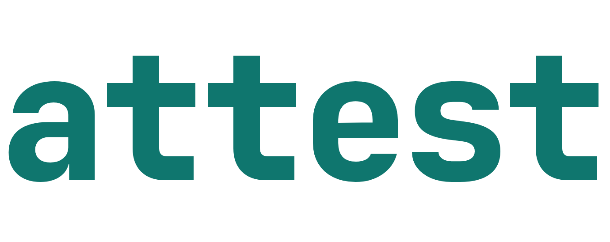
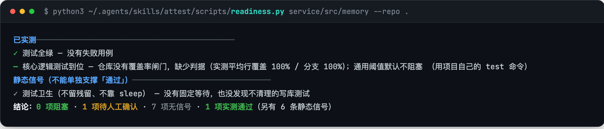

[](https://github.com/mcgrapeng/attest/actions/workflows/ci.yml)
[](LICENSE)
[](https://www.python.org/)
[](https://skills.sh/mcgrapeng/attest)
[](https://github.com/mcgrapeng/attest/stargazers)

<div align="center">
  <picture>
    <source media="(prefers-color-scheme: dark)" srcset="https://raw.githubusercontent.com/mcgrapeng/attest/main/skills/attest/assets/attest-wordmark-dark.png">
    
  </picture>
  <p><strong>把一个模块的交付前提，变成可机读、可核对、可审计的证据清单。</strong></p>
</div>

<div align="center">
  
</div>

```bash
npx skills add mcgrapeng/attest        # 安装 —— 不用 clone，不用 Python
python3 ~/.agents/skills/attest/scripts/readiness.py <模块路径> --repo <项目根>
```

## attest 是什么

`attest` 是一套需求级测试工具包。接一条需求，产出一份**钉得住**的测试计划 ——
每条不变式都指向一个真实存在的用例 —— 再**实测**这个模块的交付前提，把结果报出来。

测的是真的，不是推断出来的。`attest` 跑目标仓库自己的 test 命令、自己的覆盖率闸门、
自己的对账脚本，并查 PG catalog 拿真实的表结构。测不到的地方，它说「测不到」，而不是判通过。

它**不是**「能不能交付」的裁判。它给证据，决策归交付责任人。

## 状态

**在维护中，尚未发正式版本。** 工具每天在真实仓库上跑，但判据与 skill 契约在打 tag
之前仍可能变。MIT 许可。

下面每个数字都来自一条你可以重跑的命令。

| 闸门 | 测的是什么 | 结果 |
| --- | --- | --- |
| 回归套件 | 工具自身的行为，包括它已知会出现的每一种假绿 | 25/25 全绿 |
| 黄金 fixture | 在钉死期望的小仓库上，结论是否一致 | 5/5 命中，0 不符 |
| 行为 eval | 「用户这么说 ⇒ 工具这样回」是否成立 | 6/6 通过 |
| 安全扫描 | SkillSpector 发现项 vs 规则级 allowlist | allowlist 之外 **0** 条 |
| 环境收口 | 有没有生产脚本整份继承 `os.environ` | 没有 |
| 反向验证 | 故意注入缺陷后判据会不会翻红 | 通过 |

触发准确度（精确率 1.0、召回率 0.5）见 [evals/README.md](evals/README.md)。它测的是
**当时那台机器上的竞争环境**（装了 60 多个 skill），换个 skill 集合这两个数不可迁移。

## 为什么需要 attest

每次评审都要回答「这个模块能交付了吗」，而答案通常是看一眼覆盖率数字、相信一份清单。
这两样都会骗人，而且骗法不容易被发现：

- **覆盖率不等于测试有劲**。行覆盖 90% 只说明代码跑过，不说明断言会失败。断言恒真的
  测试套件，穿过所有缺陷都还是绿的。
- **聊天记录里的清单不是证据**。「写好了测试，已标记完成」事后核不了 —— 那条钉可能指向
  一个从来没存在过的文件。
- **两个存储、一份真相、没人盯着**。PG 与向量库悄悄漂开，漂到客户看见的时候才发现。

`attest` 的回答不是一句结论，而是**四档**：**已实测**、**静态信号**、**未实测**、
**本工具不判定**。静态信号永远不能单独支撑「通过」，而工具每份报告都固定列出一份
它拒绝去判的清单 —— 需求理解、产品行为、性能、安全、可用性、运维就绪。

**名字的由来**。*attest* 是「正式作证」：把一个说法连同它的出处记录在案，并说明这份
说法被核过。所以工具做的是这件事里**机械的那一半**，而且这一半它是当真的：失败的用例
会被点名、覆盖率会被实测、漂移会被归到租户上；出现阻塞项、或者关键判据根本没测到，
退出码就是 1。

它不做的是打出「可以交付」这个结论 —— 因为那个结论还压在几件**代码里读不出来**的事上：
需求是不是被理解对了、行为对不对、快不快、安不安全。这几项每次报告都列在 **本工具不判定**
里，决策仍然归交付责任人。这也是名字避开 *verify*、*certify*、*sign-off* 的原因：这三个词
都承诺了一个批准，而这个工具不肯替人做批准。（这个词和 SLSA 供应链里的 *attestation*
（出处证明）同源，说的也是同一件事。）

### 它怎么测

- **门槛归仓库所有**。仓库有覆盖率闸门就驱动它，判定看它的退出码；通用阈值只在仓库
  没有闸门时兜底（且默认不阻塞）。
- **实测优先**。每条判据要么有实测证据，要么明说缺哪个前提。静态推断不能冒充实测。
- **跑不起来 ≠ 不达标**。setup 报错、缺产物、连不上中间件，都判 skipped 并说清缺什么。
- **判交付看生产租户**。测试租户的漂移是夹具状态，报 warn，不阻塞。
- **跨存储字段级比对**。同一个 id 在权威库与派生库里的同一个字段值对不上，点名 id 与字段。
- **覆盖率高 ≠ 测试有劲**。覆盖率只说明代码被执行过，不说明断言会失败 ⇒ 另有一条判据专门管这个。
- **环境没就绪 ≠ 杀死了**。变异点跑出的是环境错误而不是断言失败时，那个点判**未判定**，
  不算「测试发现了缺陷」。

## 它测什么：14 条判据

工具的输出正文是中文，下表第一列是它**实际打印的判据名**，`key` 是 `--json` 里的机器可读标识。

| 判据 | key | 证据类别 | 怎么测 |
| --- | --- | --- | --- |
| 测试全绿 | `tests-green` | 实测 | 用**项目自己的** test 命令跑模块测试，列出失败用例（**只认断言失败**；setup 报错 = 环境没就绪 ⇒ 未实测） |
| 核心逻辑测试到位 | `coverage` | 实测 | **驱动仓库自己的覆盖率闸门**；没闸门才用 `--min-line-coverage` 显式指定 |
| 测试能发现缺陷 | `test-strength` | 实测 | 把源码改坏再跑测试：测试红了 = 杀得死，测试还绿 = **这套测试发现不了这类缺陷**（`--mutation-check`，默认不跑 ⇒ 默认未实测） |
| 表结构基本合规 | `schema` | 实测 | 查 PG catalog：主键 / 唯一约束 / 租户列 / RLS+FORCE / 时间戳带时区（单租户、配置表、追加表有豁免） |
| 数据流一致（跨存储对账） | `data-flow` | 实测 | **实跑**模块自己的对账脚本，解析漂移；**按租户口径**判；字段级比对并入这条 |
| 数据准确（基线对拍） | `data-accuracy` | 实测 | **实跑**仓库自己的基线对拍脚本，解析指标差异 |
| 需求覆盖到位 | `requirement` | 静态 | 读计划与测试文件：每条不变式的钉 → 真实存在的用例（`--plan`）；计划未经人工确认时降为提醒级 |
| 向量集合属性自洽 | `vector-schema` | 静态 | 同一集合在不同调用点的维度/度量/分区键是否一致；分区键不能是向量字段 |
| 测试卫生（不留残留、不靠 sleep） | `hygiene` | 静态 | 固定等待（flaky 源）与不清理的写库测试（残留源） |
| 导出的逻辑都有测试 | `uncovered-exports` | 静态 | 导出的函数/类在测试里零引用 ⇒ 点名 |
| 不过度抽象 | `extensibility` | 静态 | 导出符号全仓几乎没有调用点 |
| 没有重复造轮子 | `no-wheels` | 静态 | 全仓同名实现 |
| 使用主流开源库 | `open-source` | 静态 | 模块真实依赖清单（排除路径别名与标准库） |
| 断言的期望值独立 | `oracle` | 静态 | 期望值取自被测对象自身的断言 ⇒ 提醒 |

**证据类别说的是「这条判据靠什么得出」**（跑出来的 vs 读源码读出来的）。它同时决定报告里它落在哪一节，
而且**按每次结果**标：需要数据库的判据连不上库时标成「未实测」，绝不会标成「实测」。

## 输出长什么样

下面是仓库自带 fixture（`fixtures/ts-colocated`）的真实输出：

```
将执行的仓库脚本：测试车道（逐个测试文件跑 $ node --test <测试文件>）

交付就绪度分析 — src
仓库：<repo root>
源码 1 文件（+0 个测试支撑） / 单测 1 个 / itest 0 个

── 已实测 ───────────────────────────────────────────
  ✓ 测试全绿 — 没有失败用例
  — 核心逻辑测试到位 — 仓库没有覆盖率闸门，缺少判据（实测平均行覆盖 100% / 分支 100%）；通用阈值默认不阻塞 （用项目自己的 test 命令） 
      · calc.ts: 行100% 分支100% 函数100%

── 静态信号（不能单独支撑「通过」） ──────────────────────────────
  ✓ 测试卫生（不留残留、不靠 sleep） — 没有固定等待，也没发现不清理的写库测试
  ✓ 导出的逻辑都有测试 — 2 个运行时导出都有测试引用
  ✓ 不过度抽象 — 2 个导出符号都有多个调用点
  ✓ 没有重复造轮子 — 模块的导出符号在全仓都是独一份
  · 使用主流开源库 — 模块没有第三方依赖 —— 确认这是有意的（简单优先）
      → 如果需求领域有成熟库，别自己写
  ✓ 断言的期望值独立 — 扫了 1 个测试文件，没发现期望值取自被测对象自身的断言

── 未实测 ───────────────────────────────────────────
  — 测试能发现缺陷 — 未实测：加 --mutation-check 才会把源码改坏再跑测试（要复制工作区并多次跑测试，很贵）
  — 表结构基本合规 — 没连上数据库（或模块不碰 PG）
  — 向量集合属性自洽 — 这个模块没有向量集合调用点（判不了）
  — 数据流一致（跨存储对账） — 模块只碰了 PG 一个存储 —— 没有派生层要跨存储校对
  — 数据准确（基线对拍） — 项目里没有基线对拍脚本
  — 需求覆盖到位 — 没给计划文件（--plan）

── 本工具不判定 ────────────────────────────────
  需求是否被正确理解 · 产品行为是否正确 · 性能 · 安全 · 可用性 · 运维就绪
  上面只是测试就绪度的实测结果；「能不能交付」仍要人判断。

结论：0 项阻塞 · 1 项待人工确认 · 7 项无信号 · 1 项实测通过（另有 6 条静态信号）
退出码 1 = 有阻塞项，或关键判据（测试是否绿）没测到
```

注意最后一行：**7 项无信号**，不是「7 项通过」。没测到的判据报「未实测」。

报告分四段 —— **已实测**、**静态信号**、**未实测** —— 外加一份固定的 **本工具不判定** 清单。
结论本身分三档：**阻塞项**（实测且不达标）、**待人工确认**（测了，但要人拿主意）、
**无信号**（没测到）。退出码 `0` 表示没有阻塞项，`1` 表示有阻塞项或关键判据没测到，
`2` 表示认不出这个模块 —— 它说清原因，而不是给一个假结论。

## 安装与使用

**一条命令 —— 不用 clone，不用装 Python：**

```bash
npx skills add mcgrapeng/attest
```

这是 [skills CLI](https://skills.sh)。它把 skill 复制到当前项目的
`.agents/skills/attest/`（或全局目录），并自动识别你用的 agent：Claude Code、
Codex、OpenCode、Cursor、Windsurf、Zed、Warp 等 20 多个。skill 是自包含的 ——
`SKILL.md`、脚本与资源一起走。

**从 clone 装**（本仓库是源头）：

```bash
git clone https://github.com/mcgrapeng/attest.git && cd attest
python3 install.py
```

安装脚本把仓库里的 skill 目录（`skills/attest/`）软链到 `~/.agents/skills/attest`，
再软链到 `~/.claude/skills/`、`~/.codex/skills/` 和 `~/.config/opencode/skills/`，
于是 **Claude Code、Codex、OpenCode** 都能加载。已存在的同名软链会被覆盖（会打印提示）；
目标位置若是**真实目录**则跳过，不删用户数据。卸载：`python3 install.py --uninstall`
（或 `bash uninstall.sh`），只删软链。Windows 上 `os.symlink` 可能需要管理员权限或
开发者模式；失败时会打印等价的手工命令。

skill 契约（什么时候触发、必须做什么）在 [SKILL.md](skills/attest/SKILL.md)。装好之后，
agent 跑的就是 CLI 那一条命令：

```bash
python3 "$SKILL_DIR/scripts/readiness.py" <模块路径> --repo <项目根>
```

四条命令与全部开关见 [SKILL.md](skills/attest/SKILL.md)。最该先知道的几个：

| 开关 | 干什么 |
| --- | --- |
| `--dry-run` | **只列出**将要执行的仓库脚本与命令（含仓库自己的 test 命令），然后退出（不执行） |
| `--plan <文件>` | 要核对的需求测试计划 |
| `--json` | 机器可读输出（checks + 结论计数） |
| `--self-check` | 反向验证：往**临时副本**注入一个已知缺陷，证明判据会翻红。不改你的仓库 |
| `--mutation-check` | 测试强度：把源码改坏，看**测试会不会红**。很贵，默认不跑 |

打包成 `.skill` 分发：

```bash
python3 package.py            # → dist/attest.skill
python3 package.py --check    # 只看会打进包的内容，不写文件
```

## 语言支持

| | 计划生成 | 覆盖率实测 | 导出引用判据 | 跨存储对账 | 真后端 itest 车道 |
| --- | --- | --- | --- | --- | --- |
| TypeScript / JavaScript | ✅ | ✅ node / vitest / jest | ✅ | ✅ | ✅ |
| Python | ✅ | ✅ pytest-cov | ✅ 模块级 `def`/`class` | ✅ | ✅ |
| Rust / Go | 部分（复用侦察） | — 识别不到模块 | — | — | — |

计划生成器在复用侦察里认 Rust 与 Go 的导出（导出索引认 Rust `pub fn` 与 Go 顶层函数），
`req_plan.py scaffold` 也有 Rust / Go 分支。停在语言边界上的是**就绪度判定器** ——
它退出码 2 并说清「当前只实现了 TS/JS/Python」。「支持了但没数据」与「认不出来」是两回事，
只有后者是真的。一个满屏 ✓ 但其实什么都没测的报告，比报错更糟。

## 安全须知

`readiness.py` 会**执行目标仓库自己定义的脚本**（`package.json` 里的 `test`、`coverage`、
`reconcile`、`eval:baseline:check` 等）。三件事要知道：

1. **先看它要跑什么**。`--dry-run` 只列出候选脚本与将执行的命令，不执行。正常模式下工具
   会在执行前打印那一行 —— 它是审计入口，而且**包含仓库自己的 test 命令**（工具跑得最多的
   一层，逐个测试文件跑）。

   脚本选取有**两条规则**，按生态不同：

   - **JS 仓（`package.json`）**：**显式白名单**（精确脚本名或白名单前缀），名字里只带
     关键词的脚本（例如 `reconcile:reset`）不会被自动执行。
   - **Python 仓（Makefile / tox.ini）**：按**目标名里的关键词**认（`cov` / `reconcile` /
     `integration` / `itest`），且必须**成词** —— `coverage`、`test-coverage`、`py-cov` 认，
     `recover`、`cover` 不认。覆盖率闸门额外接受「模块目录或其上层」的 Makefile（所以全仓一个
     `make coverage` 仍然算数），对账与真后端两条车道还要求配方或命令提到本模块。

   Python 那条更松：名字像覆盖率闸门的目标会被跑起来。工具不会跑仓库自己没有声明的东西，
   `--dry-run` 会把到底会跑哪些目标列出来 —— 不想让它被认成闸门，就别给目标起像闸门的名字。

2. **子进程只拿到白名单环境变量**：`PATH`、`HOME`、`LANG`/`LANGUAGE`、`TZ`、
   `TMPDIR`/`TEMP`/`TMP`、`SHELL`、`USER`/`LOGNAME`、`TERM`、`CI`、
   `SYSTEMROOT`/`COMSPEC`（Windows），前缀 `LC_*`、`NODE_*`、`PYTHON*`，以及工具自己需要的
   `POSTGRES_URL` / `DATABASE_URL` / `MEMORY_ITEST` / `MEMORY_RECONCILE_OUT_DIR` /
   `REQ_PLAN_RECONCILE_OUT_DIR`。

   **名单之外的一律不透传**：你的云厂商密钥（`AWS_*` / `GCP_*` / `AZURE_*`）与**仓库凭据**
   （`NPM_TOKEN`、`NODE_AUTH_TOKEN`、`PIP_INDEX_URL`（常把密码写在 URL 里）、
   `UV_INDEX_SECRET_PASSWORD`）都不会进目标仓库的脚本。`NPM_*` / `PNPM_*` / `YARN_*` /
   `PIP_*` / `UV_*` 这些前缀**根本不在白名单里**，而 `NODE_AUTH_TOKEN` 虽落在 `NODE_*`
   前缀里，也在**单独的拒绝名单**上。仓库的 test 命令需要 npm 或 pip 配置时，用配置文件
   （`.npmrc`、`pip.conf`），别放环境变量。

   那两个连接串**会**透传：仓库自己的集成车道要连库，这是刻意的取舍。真正能用的开关只有两个：
   把 `POSTGRES_URL` / `DATABASE_URL` 从环境里 unset 掉、改用 `--database-url` 传
   （它不读环境变量，所以不会进子进程环境）；或者设 `PGHOST` / `PGUSER` / `PGDATABASE`，
   口令让 `psql` 从 `.pgpass` 读 —— 只上 `.pgpass` 不够，schema 判定只读 `PG*` 变量，
   没有它们就判「未实测」。`psql` 的口令走 `PGPASSWORD` 环境变量，不出现在命令行参数里。

3. **信任一个仓库的 `test` 脚本，就等于把它交给了你的环境变量**。这一层的风险等级 = 它所
   运行的每一个脚本的风险等级。带 `--self-check-deps` 时，副本里的 `node_modules` /
   `.venv` 是**指向真实目录的软链** —— 测试若往依赖目录里写东西，写的是真的那个。

`req_plan.py scaffold` 会向仓库写测试文件。写入前有两道闸：钉的路径必须规范化后仍在
`--out-dir` 之下（越界的钉既不读也不写），用例名按语言做引号转义（计划 markdown 不会被
变成可执行代码）。认不出仓库的测试约定时它**拒绝生成**并报红，不猜。

## 已知缺口

发布时仍开放七条。完整清单与每条的推理见 [CHANGELOG.md](CHANGELOG.md) 的「已知遗留」，
评审记录见 [docs/oss-release-review.md](docs/oss-release-review.md) 与
[docs/testing-philosophy-review.md](docs/testing-philosophy-review.md)。

- **SkillSpector 的 `E2`** 仍报 HIGH。CI 用规则级 allowlist 缓解：已复核的规则有名有姓，
  新规则仍然拦住构建。
- **没有 `--exec` 开关**。默认执行，执行前打印审计行；`--dry-run` 能看执行清单。
- **Python 的真后端车道**：此前只跑不判，加了 pytest 输出解析后才给结论。
- **Windows 未端到端验证**。运行时与安装器跨平台，仓库自己的开发脚本要 bash。
- **触发召回 0.5**：测的是当时那台机器的竞争环境，不是描述词的问题。
- **自检副本默认不带 `node_modules`**；`--self-check-deps` 把它们软链进去。
- **向量集合是否与线上真实租户一致**不判：那条要连活的向量库并用项目自己的凭据。

## 开发与贡献

本仓库把自己的工具用在自己身上。

| 闸门 | 命令 |
| --- | --- |
| 回归套件 | `for t in skills/attest/scripts/test_*.py; do python3 "$t"; done` |
| 黄金 fixture | `bash fixtures/run_fixtures.sh` |
| 行为 eval | `python3 evals/run_evals.py` |
| 安全扫描 | `bash .github/check-skillspector.sh`（需要 `skillspector`） |
| 环境收口 | `python3 skills/attest/scripts/check_env_inheritance.py` |
| 反向验证 | `python3 skills/attest/scripts/selfcheck.py src --repo fixtures/ts-colocated` |
| README 一致性 | `python3 skills/attest/scripts/test_readme_sync.py` |

环境准备与 PR 约定见 [CONTRIBUTING.md](CONTRIBUTING.md) —— 其中包括能抓到中英两份 README
漂移的那道一致性检查。

## 参与共建

attest 才一天大，它本来就该由不止一个人来建。[路线图](docs/roadmap.md) 写了接下来
做什么、以及外部帮忙在哪一块最值钱。

- **拿你自己的仓库跑一遍**，然后报告它哪里判错了 —— 两个方向都算：漏判（假绿）
  和误判（假红）都是 bug。
- **跟某条判据吵一架**。一条经不起质疑的判据，本身就是 bug。
- **从 issue 里挑一个 *good first issue***。
- **移植它** —— 换一个 agent、换一门语言、换一套 CI。

## License

MIT
