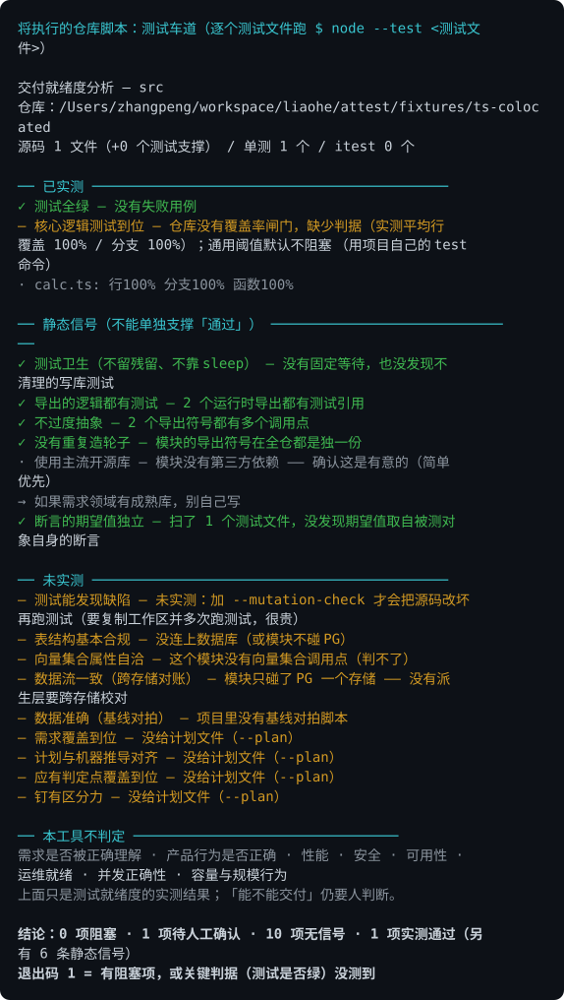

<div align="center">
  <picture>
    <source media="(prefers-color-scheme: dark)" srcset="https://raw.githubusercontent.com/mcgrapeng/attest/main/skills/attest/assets/attest-wordmark-dark.png">
    
  </picture>
  <p><strong>把「这个模块能不能交付？」从一个覆盖率百分比，变成一份可机读、可核对、可审计的证据清单。</strong></p>
</div>

<div align="center">

[](https://github.com/mcgrapeng/attest/actions/workflows/ci.yml)
[](https://skills.sh/mcgrapeng/attest)
[](https://www.python.org/)
[](LICENSE)

[English](README.md) · [中文](README.zh-CN.md)

</div>

```bash
npx skills add mcgrapeng/attest
```


## 它做什么

覆盖率数字只说明代码跑过了。它不说明：断言会不会红、计划里钉的文件是不是真的存在、
两个存储是不是已经漂了。`attest` 用**证据**回答交付问题，证据分四档：

| 证据种类 | 什么意思 |
| --- | --- |
| **已实测** | 真跑了 —— 命令、退出码、输出都在报告里 |
| **静态信号** | 从源码读出来的，没跑。**永远不能单独支撑「通过」** |
| **未实测** | 测不了，报告里点名缺哪个前提 |
| **本工具不判定** | 按设计不判：需求是否被理解对、产品行为、性能、安全、可用性、运维就绪 |

**目前支持**：TypeScript / JavaScript 与 Python。Rust 与 Go 计划生成器认得出来，
但就绪度检查会退出码 2 并说清原因 —— 它不会对着读不懂的模块出报告。

实测就是实测，不是推断。`attest` 跑目标仓库**自己**的 test 命令、**自己**的覆盖率闸门、
**自己**的对账脚本，并直接查 PostgreSQL 的 catalog 拿真实表结构。测不了的地方它就
说测不了，而不是判它通过。

**它不是什么。** 它不是「能不能交付」的裁判，也不替代你已有的工具：

| 你已经熟悉的东西 | attest 的不同 |
| --- | --- |
| 覆盖率徽章（Codecov、SonarCloud） | attest **驱动你仓库自己的覆盖率闸门**、读你 CI 本来就产出的那个数字 —— 它自己不报覆盖率 |
| AI 写的测试计划 | attest 把每条不变式钉到**你仓库里真实存在**的用例上；认不出你的测试约定时它拒绝生成 |
| 「我问了聊天机器人，看着像做完了」 | attest **真去跑**，并把它跑过的命令打印出来 —— 每条结论你都能自己复跑 |
| PR 评论里的一份 checklist | attest 的报告可复现：一条命令，同样的输入，同样的输出 |

它给证据，交付决策仍在拥有交付的人手里。名字刻意避开 verify / certify / sign-off ——
那三个词承诺的是一次批准，而这个工具不肯替人做批准。

## 安装

```bash
npx skills add mcgrapeng/attest
```

三种进入方式，按你的处境选：

| 你想… | 就这么做 |
| --- | --- |
| 在 agent 里用它 | `npx skills add mcgrapeng/attest` —— skills CLI 把 skill 复制到 `.agents/skills/attest/` 并自动识别你用的 agent（Claude Code、Codex、OpenCode、Cursor、Windsurf、Zed、Warp 等 20 多个），不用 clone、不用装 Python |
| 把仓库留在本地 | `git clone … && python3 install.py` —— 软链到 `~/.agents/skills/attest` 与各 agent 目录 |
| 只跑一次 | `python3 ~/.agents/skills/attest/scripts/readiness.py <模块路径> --repo <项目根>` |

从 clone 装（本仓库是源头）：

```bash
git clone https://github.com/mcgrapeng/attest.git && cd attest
python3 install.py
```

安装脚本把仓库里的 skill 目录（`skills/attest/`）软链到 `~/. agents/skills/attest`，
再软链到 `~/. claude/skills/`、`~/. codex/skills/` 和 `~/. config/opencode/skills/`。 已存在的同名软链会被覆盖（会打印提示）； 目标位置若是**真实目录**则跳过，不删用户数据。 卸载：`python3 install. py --uninstall`，只删软链。

Windows 上 `os. symlink` 可能需要
管理员权限或开发者模式。

只需要 Python 3.11+，**没有任何第三方依赖** —— 它驱动的是**你仓库自己的**工具链
（node、pytest……），不自带一套。

然后，对着任意仓库：

```bash
python3 ~/.agents/skills/attest/scripts/readiness.py <模块路径> --repo <项目根>
```

### 在 CI 里

```yaml
name: attest
on: [pull_request]

jobs:
  attest:
    runs-on: ubuntu-latest
    steps:
      - uses: actions/checkout@v4
      - uses: actions/setup-node@v4
        with:
          node-version: '22'
      - run: npm ci
      - uses: mcgrapeng/attest@v0.1.7
        with:
          module: src/auth
```

| 输入 | 默认 | 干什么 |
| --- | --- | --- |
| `module` | — | **必填。** 要检查的模块路径，相对仓库根（`src/auth`） |
| `repo-path` | `.` | 仓库根（不在 workspace 根时用） |
| `plan` | — | 要核对的需求测试计划 |
| `strict` | `false` | attest 报出阻塞项时是否让 job 失败 |
| `comment` | `true` | 是否把报告发成 PR 评论 |

它把证据清单写进 job summary 和 PR 评论，**默认不拦合并**（`strict: false`）——
attest 给证据，仓库自己决定。attest 即使退出 1（有阻塞项，或关键判据没测到），
job 仍然是绿的；改成 `strict: true` 才会让那次退出码把 job 判红。跑 action 之前先装好仓库自己的依赖：attest 跑的是
仓库自己的 test 命令。

## 报告长什么样

attest 自己 fixture（`fixtures/ts-colocated`）的真实输出。工具的输出是中文 ——
判据名与结论行就是你终端里看到的东西：

```
将执行的仓库脚本：测试车道（逐个测试文件跑 $ node --test <测试文件>）

交付就绪度分析: src
仓库：<repo root>
源码 1 文件（+0 个测试支撑） / 单测 1 个 / itest 0 个
```

```
结论：0 项阻塞 · 1 项待人工确认 · 7 项无信号 · 1 项实测通过（另有 6 条静态信号）
退出码 1 = 有阻塞项，或关键判据（测试是否绿）没测到
```

<div align="center">
  
</div>

看最后一行：**7 项无信号**，不是「7 项通过」。没测到的判据报的是「未实测」，
而退出码是 1 —— 因为有一项关键判据根本没测到。

`--json` 给同一份东西的机器可读版（checks + 结论计数）。`--dry-run` 只列出**将要**
执行的仓库脚本，什么都不跑。

## 它测什么

14 条判据，名字列在这里：测试全绿 · 核心逻辑测试到位 · 测试能发现缺陷 · 表结构基本合规 ·
数据流一致（跨存储对账）· 数据准确（基线对拍）· 需求覆盖到位 · 向量集合属性自洽 ·
测试卫生 · 导出的逻辑都有测试 · 不过度抽象 · 没有重复造轮子 · 使用主流开源库 ·
断言的期望值独立。

每一条怎么测、四档证据的说明和语言支持矩阵在
**[docs/criteria.md](docs/criteria.md)**。

## 状态

**在维护中，已发 `v0.1.7`。** 判据与 skill 契约仍可能变 —— 但会带着 changelog 条目变，
不会悄悄变。MIT 许可。

仓库里的每个数字都来自一条你能重跑的命令：**27 / 27** 回归套件、**5 / 5** 黄金 fixture、**6 / 6** 行为 eval、allowlist 之外 **0** 条安全发现。

已知缺口全文见 [CHANGELOG.md](CHANGELOG.md)（已知遗留）。最要紧的三条：

- **触发召回率 0.5** —— 那是在当时那台机器上测的，这个数说的是**那台机器上的竞争**，
  不是描述本身。
- **Windows 没有端到端验证**。运行时与安装是跨平台的，仓库自己的开发脚本要 bash。
- **自检副本默认不带 `node_modules`**，`--self-check-deps` 会软链进去。

attest 还被拿去跑了五个公开仓库，并**把结论公开了 —— 包括让工具显得难看的那些**：
[docs/self-test-report.md](docs/self-test-report.md)。

## 参与共建

[CONTRIBUTING.md](CONTRIBUTING.md) 里有环境准备、一个 PR 要过的闸门、以及外部帮忙
在哪一块最值钱。安全漏洞请走 [SECURITY.md](SECURITY.md)，不要发 issue；
参与的人都要遵守[行为准则](CODE_OF_CONDUCT.md)。

## License

MIT。

最后一句留给证据：attest 在五个公开仓库上跑出来的结论 —— **包括让工具显得难看的那些** ——
都公开在 [docs/self-test-report.md](docs/self-test-report.md) 里。
