<div align="center">
  <picture>
    <source media="(prefers-color-scheme: dark)" srcset="https://raw.githubusercontent.com/mcgrapeng/attest/main/skills/attest/assets/attest-wordmark-dark.png">
    
  </picture>
  <p><strong>把「这个模块能不能交付？」从一个覆盖率百分比，变成一份可机读、可核对、可审计的证据清单。</strong></p>
</div>

<div align="center">

[](https://github.com/mcgrapeng/attest/actions/workflows/ci.yml)
[](https://skills.sh/b/mcgrapeng/attest)
[](https://www.python.org/)
[](LICENSE)

[English](README.md) · [中文](README.zh-CN.md)

</div>

```bash
npx skills add mcgrapeng/attest
```

<div align="center">
  
</div>

## 它做什么

覆盖率数字只说明代码跑过了。它不说明：断言会不会红、计划里钉的文件是不是真的存在、
两个存储是不是已经漂了。`attest` 用**证据**回答交付问题，证据分四档：

<div align="center">
  
</div>

| 证据种类 | 什么意思 |
| --- | --- |
| **已实测** | 真跑了 —— 命令、退出码、输出都在报告里 |
| **静态信号** | 从源码读出来的，没跑。**永远不能单独支撑「通过」** |
| **未实测** | 测不了，报告里点名缺哪个前提 |
| **本工具不判定** | 按设计不判：需求是否被理解对、产品行为、性能、安全、可用性、运维就绪 |

工具打印的就是这四档的中文名（已实测 / 静态信号 / 未实测 / 本工具不判定）；下面那份
报告样例是它的真实输出。

实测就是实测，不是推断。`attest` 跑目标仓库**自己**的 test 命令、**自己**的覆盖率闸门、
**自己**的对账脚本，并查 PostgreSQL catalog 拿真实表结构。测不了的东西它说清缺什么，
而不是报个通过。

**目前支持**：**就绪度检查器**测 TypeScript / JavaScript 与 Python。（Python 的真后端
itest 车道能被找到、也能用 `--include-itest` 跑起来，但 pytest 的输出不是 attest 认得的
形态，解析不出结果 —— 那条车道只会停在「未实测」，而不是变成一次判定。）**计划生成器**
也认 Rust / Go —— 侦察时读它们的导出，生成骨架时按扩展名选风格（`.rs` → cargo test、
`.go` → go test）；但就绪度检查器卡在语言边界上：对着 Rust / Go 的模块它退出码 2 并说清
「当前只实现了 TS/JS/Python」，而不是对着一个它看不见的模块出报告。

**它不是什么**。它不是「能不能发」的裁判，也不替代你已有的工具：

| 你已经知道的 | attest 的不同 |
| --- | --- |
| 覆盖率徽章（Codecov、SonarCloud） | attest **驱动你仓库自己的覆盖率闸门**，报你 CI 已经产出的那个数字 —— 只有仓库自己没有闸门时，attest 才自己测覆盖率作为兜底 |
| 一份 AI 写的测试计划 | attest 把每条不变式钉到**你仓库里真实存在**的用例；认不出你的测试框架时它拒绝生成骨架并说清（`--framework` 是那个出口） |
| 「我问了聊天机器人看着像不像做完了」 | attest **跑**这些检查，并把它跑过的命令打出来：每条结论你都能自己重跑一遍 |
| PR 评论里的一张清单 | attest 的报告可复现：一条命令，同样的输入，同样的输出 |

它报证据，决定权留给交付的负责人。名字里刻意避开 *verify*、*certify*、*sign-off* ——
那三个词承诺的是一种它拒绝伪造的批准。

## 两条命令

**线A 写计划** —— `skills/attest/scripts/req_plan.py`：

| 步 | 命令 | 干什么 |
| --- | --- | --- |
| 1 | `new <feature> --repo . --module src/x` | 扫模块：它已有的 helper、它碰到的存储、你的测试车道，以及代码里的判定点 |
| 2 | *填计划* | 写不变式与覆盖矩阵；每条钉到真实存在的用例 |
| 3 | `upgrade <plan> --repo .` | 把计划改成判定点粒度：一个判定点一行，三列要填 —— 归哪条不变式、钉到哪个用例、或写明为什么不用测 |
| 4 | `assign <plan> --repo . --limit 30` | 把还没答的判定点以 JSONL 工单发出来（默认就是这一步）；`--apply answers.jsonl` 校验后写回 |
| 5 | `scaffold <plan> --repo .` | 按计划生成测试文件，用你仓库的约定；断言留成 TODO 给你填 |
| 6 | `check <plan> --repo .` | 核对每一个钉：文件在不在、用例在不在、不变式有没有被覆盖 |
| 7 | `reconcile <plan> --repo .` | 按计划的数据一致性节生成跨存储对账脚本 —— 表名与集合名从计划里抽好，还没填的槽位会让脚本拒绝运行，所以它不可能静默通过 |

第 4 步是让那三列能由 agent 填、而不是由人手填的关键：默认状态下 `assign` 把每个判定点的
源码、候选测试文件、计划自己的不变式一起交出去；`--apply` 把答案收回来并写回计划。核不过的
一律不写 —— 归属了计划里没有的不变式、理由等于没说的豁免、钉到不存在的用例，都退回来
留给人。

**线B 验收交付** —— `skills/attest/scripts/readiness.py`：
`readiness.py <模块路径> --repo .` 跑目标仓库自己的测试车道、覆盖率闸门、对账脚本与表结构
查询，然后打出四档证据与一个退出码。`--plan <计划>` 会加上三条判定点判据；不给它，
这三条一律报「未实测」，不是通过。

**全程不需要人在场。** 一个读过需求的 agent 可以把两条线一路走完：从需求派生不变式、
用 `assign` 批量填计划、把 `scaffold` 留下的 TODO 断言填掉、确认计划（「确认」节接受
agent 确认，报告会写清是谁确认的）、认领那八项本工具不判定的事、跑就绪度检查。报告
最后有一节**交付前置条件** —— 证据齐、计划已确认、没有无人认领项 —— 这就是「可以进
交付流程」的意思。它是**汇总，不是又一条判据**：判据条数与退出码都不变。

## 安装

```bash
npx skills add mcgrapeng/attest
```

三条路，按你需要的选：

| 你要… | 这么做 |
| --- | --- |
| 在 agent 里用 | `npx skills add mcgrapeng/attest`：skills CLI 把 skill 复制进 `.agents/skills/attest/`，并认出你在用哪个 agent。不用 clone，不用装 Python |
| 留一份仓库 | `git clone … && python3 install.py`：软链到 `~/.agents/skills/attest` 与各 agent 目录 |
| 只跑这一次 | `python3 ~/.agents/skills/attest/scripts/readiness.py <模块路径> --repo <仓库根>` |

这两条路把 skill 放在不同地方：skills CLI 复制进项目里（`.agents/skills/attest/`），
`install.py` 软链到你家目录（`~/.agents/skills/attest/`）。上面那条命令是家目录那条路；
从 skills CLI 装的，用 `.agents/skills/attest/scripts/readiness.py`。

从 clone 装（这个仓库是源头）：

```bash
git clone https://github.com/mcgrapeng/attest.git && cd attest
python3 install.py
```

安装脚本把 skill 目录（`skills/attest/`）软链到 `~/.agents/skills/attest`，再把那条软链
链进 `~/.claude/skills/`、`~/.codex/skills/`、`~/.config/opencode/skills/`。同名软链会被替换
（脚本会说）；目标位置要是**真目录**，它会跳过，绝不删用户数据。卸载用
`python3 install.py --uninstall`：只删软链。Windows 上 `os.symlink` 可能需要管理员权限
或开发者模式。

Python 3.11+，就这一样：工具**没有第三方依赖**，它驱动你仓库自己的工具链（node、pytest…），
而不是自己装一套。

对着任意仓库：

```bash
python3 ~/.agents/skills/attest/scripts/readiness.py <模块路径> --repo <仓库根>
```

### 在 CI 里

```yaml
name: attest
on: [pull_request]

jobs:
  attest:
    runs-on: ubuntu-latest
    steps:
      - uses: actions/checkout@v4
      - uses: actions/setup-node@v4
        with:
          node-version: '22'
      - run: npm ci
      - uses: mcgrapeng/attest@v0.1.21
        with:
          module: src/auth
```

| 输入 | 默认 | 干什么 |
| --- | --- | --- |
| `module` | — | **必填**。要检查的模块，相对仓库根（`src/auth`） |
| `repo-path` | `.` | 仓库根（当它不是工作区根的时候） |
| `plan` | — | 拿来核对的需求测试计划 |
| `strict` | `false` | attest 退出码 1（阻塞项，或关键判据没测到）时让 job 失败 |
| `comment` | `true` | 把报告发成 PR 评论 |

它把证据清单发到 job summary 与 PR 评论，**默认不拦合并**（`strict: false`）：attest 报
证据，仓库做决定。attest 退出码 1（阻塞项或关键判据测不了）时 job 仍然是绿的；
`strict: true` 才让那个退出码把 job 打红。退出码 2 是例外：attest 读不懂这个模块，
不管 `strict` 怎么设，action 都会让 job 失败。action 跑之前要先装好仓库自己的依赖 ——
attest 跑的是仓库自己的 test 命令。

## 命令行开关

最常用的这些：

| 开关 | 干什么 |
| --- | --- |
| `--plan <文件>` | 要核对的需求测试计划。**不给它，三条判定点判据一律跳过**，不是通过 |
| `--database-url <url>` | 读表结构用的 PostgreSQL（不是默认那个时） |
| `--test-tenant <名字>` | **不是**生产数据的租户。测试租户要一个一个都给出，否则对账会把它算成漂移 |
| `--include-itest` | 把真后端 itest 车道也算进测量（要连 PG + 向量库，慢） |
| `--json` | 同一份报告的机器可读版：每条判据 + 结论计数 |
| `--dry-run` | 列出**会**跑哪些仓库脚本，什么都不执行 |
| `--min-line-coverage`、`--min-branch-coverage` | 兜底的覆盖率底线，只在仓库自己没有覆盖率闸门时用 |
| `--mutation-check` | 把源码改坏，看测试抓不抓得住（先复制你的代码，工作树不动） |
| `--self-check` | 反向验证：往副本里注入一个已知缺陷，证明判据会翻红（不动你的仓库） |

另有三个开关属于判定点引擎（第四个 `--plan` 在上面）。它们都不会把红变成绿：缺能力时
降成警告，或者降成「未实测」。

| 开关 | 干什么 |
| --- | --- |
| `--discriminating {auto,off,quick,full}` | 要不要把源码在钉的位置改坏、看钉住的用例抓不抓得住。`auto` 只对判定点粒度的计划跑，`off` 不跑，`quick`/`full` 扩大样本（很贵） |
| `--analysis-backend {auto,b1,b2,l2}` | 判定点怎么推导。`auto` 有 TypeScript AST 就用；`l2` 强制词法回退，这时**三条判据降成警告** —— 缺能力绝不报绿 |
| `--lenient` | 只提醒不阻塞：三条判定点判据的报红一律降成警告 |

## 报告长什么样

attest 自己 fixture（`fixtures/ts-colocated`）的真实输出。工具的输出是中文 ——
判据名与结论行就是你终端里看到的东西：

```
将执行的仓库脚本：测试车道（逐个测试文件跑 $ node --test <测试文件>）

交付就绪度分析 — src
仓库：<repo root>
源码 1 文件（+0 个测试支撑） / 单测 1 个 / itest 0 个
```

```
结论：0 项阻塞 · 1 项待人工确认 · 11 项无信号 · 1 项实测通过（另有 6 条静态信号）
退出码 1 = 有阻塞项，或关键判据（测试是否绿）没测到
```

<div align="center">
  
</div>

看最后一行：**10 项无信号**，不是「10 项通过」。没测到的判据报的是「未实测」。
它下面那行是规则，不是这次运行的结论：**有阻塞项，或关键判据没测到 ⇒ 退出码 1**。
这次两者都没有，所以退出码是 `0`。结论行里这几个数字是重叠的：待人工确认的那条同时
也是静态信号之一，所以它们加起来不等于判据条数。去掉那处重叠，就是
1 项实测通过 + 11 项无信号 + 6 条静态信号。

`--json` 给同一份东西的机器可读版（判据 + 结论计数）。`--dry-run` 只列出**会**跑哪些
仓库脚本，什么都不执行。

带上 `--plan`，报告会多出一节**判定点覆盖** —— 从源码反推出来的判定点，跟计划自己
列的那些对账：

```
── 判定点覆盖 ────────────────────────────────
  判定点总数 2 ｜ 已归属 1 ｜ 豁免 0 ｜ 缺口 1
  高危四类缺口：drop 0 ｜ error-path 0 ｜ resource 1 ｜ state 0
  缺口清单（只列高危档）：
    src/a.ts#closeClient#resource  既没有归属不变式，也没有豁免理由
  推导等级 L3（后端 B2，来源 global-npm）
  区分力自证：1/1 条（100%），杀得死 1 条
```

那行缺口就是重点：一个**没有任何不变式认领、也没有豁免说明**的高危判定点。

## 它测什么

工具打印 18 条判据的中文名，这里给上英文说法。**实测**＝attest 真的跑了什么；**静态信号**＝
从源码读出来的，而静态信号永远不能单独撑起一个「通过」。

| 判据 | 怎么测 |
| --- | --- |
| 测试全绿 (tests green) | **实测。** 用仓库自己的命令跑模块的测试；只认断言失败 —— 搭环境失败说明的是环境没就绪，不是代码有问题 |
| 核心逻辑测试到位 (core logic is covered) | **实测。** 驱动仓库自己的覆盖率闸门；`--min-line-coverage` 只给没有闸门的仓库用 |
| 测试能发现缺陷 (the tests can find defects) | **实测。** 故意把源码改坏：红了说明这套测试抓得住，还是绿的说明它抓不住这一类缺陷（`--mutation-check`） |
| 表结构基本合规 (schema is basically compliant) | **实测。** 查 PostgreSQL catalog：主键、唯一约束、租户列、RLS+FORCE、带时区的时间戳。单租户模块、全局配置表与追加型表豁免租户列与唯一约束 |
| 数据流一致（跨存储对账）(data agrees across stores) | **实测。** 跑模块自己的对账脚本，按租户种类判漂移；字段级对比也属于这一条 |
| 数据准确（基线对拍）(data matches the baseline) | **实测。** 跑仓库自己的基线脚本，解析指标差异 |
| 钉有区分力 (the pin has discriminating power) | **实测。** 在钉的位置改坏源码再跑钉住的那个用例：红了说明这条钉杀得死这类缺陷，还是绿的说明杀不死 |
| 需求覆盖到位 (requirement is covered) | **静态信号。** 读计划与测试文件：每条不变式的钉都指向真实存在的用例 |
| 向量集合属性自洽 (vector collection attributes agree) | **静态信号。** 同一个集合的维度、度量、分区键在各调用点是否一致 |
| 测试卫生（不留残留、不靠 sleep）(test hygiene) | **静态信号。** 固定等待（flaky 的来源）与写库不留清理（残留的来源）。确实不写库的测试文件要显式声明 —— `/* attest:no-db-writes reason="…" */` —— 理由会进报告 |
| 导出的逻辑都有测试 (every export is referenced by a test) | **静态信号。** 点名那些在测试里零引用的导出函数与类 |
| 不过度抽象 (not over-abstracted) | **静态信号。** 导出的符号在全仓几乎没有调用点 |
| 没有重复造轮子 (no reinvented wheels) | **静态信号。** 仓库别处还有同名实现 |
| 使用主流开源库 (uses mainstream open-source libraries) | **静态信号。** 模块真正的依赖清单（路径别名与标准库除外） |
| 断言的期望值独立 (assertion oracles are independent) | **静态信号。** 断言的期望值来自被测对象自身 |
| 计划与机器推导对齐 (the plan matches the machine-derived decision points) | **静态信号。** 判定点从源码反推出来，与计划双向对账 |
| 应有判定点覆盖到位 (the decision points are covered) | **静态信号。** 每个高危判定点都有不变式认领或写明豁免，且落点真实存在 |
| 不变式有判定点 (every invariant reaches a decision point) | **静态信号。** 同一套对账的另一头：每条不变式至少有一个判定点认领它 —— 一个都没有的，只靠一条用例钉着 |

## 状态

**在维护中，已发 `v0.1.21`。** 判据与 skill 契约仍可能变 —— 但会带着 changelog 条目变，
不会悄悄变。MIT 许可。

仓库里的每个数字都来自一条你能重跑的命令：**38 / 38** 回归套件、**10 / 10** 黄金 fixture、
**6 / 6** 行为 eval、allowlist 之外 **0** 条安全发现。

已知缺口，全文在 [CHANGELOG.md](CHANGELOG.md)。最要紧的三条：

- **召回率 0.5**（在测它的那台机器上）：这个数字说的是那台机器上的竞争者，不是这份描述。
- **Windows 没有端到端验证。** 运行时与安装器是跨平台的；仓库自己的开发脚本要 bash。
- **自检副本默认不带 `node_modules`** ⇒ 多数仓库在副本里跑不动测试，`--self-check-deps`
  把它们软链进来。

attest 还在五个公开仓库上跑过 —— **结论里包括那些让工具显得不好看的**。

## FAQ

**要装什么才能跑？**
Python 3.11+，就这一样。attest 没有第三方依赖：它驱动你仓库自己的工具链（node、pytest…），
而不是自己装一套。目标仓库要装好自己的依赖，因为 attest 跑的是那个仓库的 test 命令。

**我的 test 脚本是复合的（`xo && c8 node --test … && tsc`），attest 应付得来吗？**
应付得来。它会把脚本拆开，跑**真正**调用测试 runner 的那一段，把你的文件接在后面。认不出
哪一段跑测试，它就实说，而不是猜。

**退出码 1 在我的 CI 里是什么意思？**
要么有一条实测判据没达标，要么有一条关键判据压根没测到。GitHub Action 默认不因此让
job 失败（`strict: false`）；`strict: true` 才会。`--self-check` 模式下还有第三种：
反向验证没通过，说的是**工具**有问题、不是你的模块，attest 会用自己的话说明。

**attest 会往我的仓库里写东西吗？**
它读你的仓库、跑你的脚本。计划命令会写**计划文件** —— `new` 建它、`upgrade` 与
`assign --apply` 改写它 —— 而 `req_plan.py scaffold` 在 `--out-dir` 里写测试文件
（默认是仓库根）。`--self-check` 与 `--mutation-check` 会先把你的代码复制到临时目录
再跑，不动你的工作树。

**它替代我的覆盖率看板吗？**
不替代，它读它。attest 驱动你仓库自己的覆盖率闸门，报你 CI 已经产出的那个数字；
仓库没有闸门时，它自己测覆盖率作为兜底。

**它能替我把计划填了吗？**
判定点计划里那三列是判断题，attest 不替你判断。但 `req_plan.py assign` 让它能一批一批地
填：把还没答的判定点以 JSONL 工单交出来，答案收回来后逐条校验再写回 —— 归属了计划里
没有的不变式、理由等于没说的豁免、钉到不存在的用例，都退回来留给人。

**有人在维护吗？**
它有发版、有版本号、改动都公开：
[CHANGELOG.md](CHANGELOG.md)。

## 参与共建

[CONTRIBUTING.md](CONTRIBUTING.md) 里有环境准备、PR 要过的闸门，以及哪里最缺外部帮忙。
安全漏洞请走 [SECURITY.md](SECURITY.md)，不要走 issue tracker；参与的人都遵守
[行为准则](CODE_OF_CONDUCT.md)。

## License

MIT.
